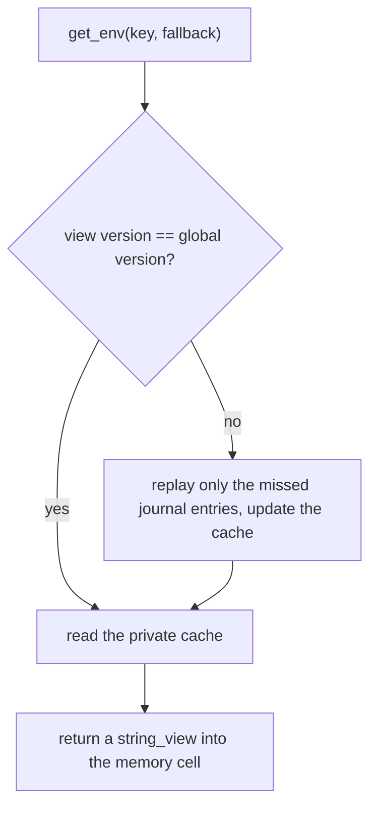

# Environment

Software is configured through the environment: what the process inherited when
it started, and what a `.env` file declares. Reading that configuration is
usually a string map behind a lock, and a lock on a hot path is exactly what a
real-time system cannot afford.

`frameworkcpp::environment` is a dotenv-style store built on the memory. Every
key and value lives in a single memory shard, reads never touch the heap or take
a lock, and values are immutable once published: a write publishes a new cell
instead of editing the old one.

The whole module is header-only and lives in one include:

```cpp
#include <frameworkcpp/environment/environment.hpp>
```

## The vocabulary

| Concept | What it is |
| --- | --- |
| **Store** | The module's memory shard. It owns the key table, the value pool, the journal and one view per thread. |
| **Key** | A name (up to `max_key_len_` bytes) that maps to the latest published value. Keys are immutable once inserted. |
| **Value** | An immutable cell holding the value bytes. `set_env` always builds a fresh cell; nothing is edited in place. |
| **View** | A per-thread cache of value pointers plus the version that cache is current to. It is what makes reads cheap. |
| **Journal** | The append-only list of updates a behind thread replays to catch up. |
| **Version** | A single global counter. A thread compares its own version with it to know whether its cache is current. |

## The mental model

1. You build ba `memory::memory_t` and call `environment::init(memory, config)`.
   The module carves its own shard out of the memory and loads the configuration:
   first the **process environment**, then the **file** named by
   `config.dotenv_path_` — and the process wins, the file only fills keys that
   are still unset.
2. `environment::get_env(key, fallback)` reads. A warmed-up thread compares its
   cached version against the global counter and, if they match, reads its own
   private cache — no shared atomic beyond that one counter, no lock, no heap.
3. `environment::set_env(key, value)` publishes a new immutable value cell,
   appends the update to the journal and bumps the global version. Writers
   serialize on a short mutex; readers never take it.

```cpp
#include <frameworkcpp/memory/memory.hpp>
#include <frameworkcpp/environment/environment.hpp>

using namespace frameworkcpp;

int main()
{
    environment::environment_config_t config;
    config.dotenv_path_ = "app.env";              // optional .env file

    memory::memory_t memory{memory::memory_config_t{}};
    environment::init(memory, config);             // process env, then the file

    environment::get_env("LOG_LEVEL", "info");   // read (never allocates)
    environment::set_env("LOG_LEVEL", "debug");  // publish a new value

    environment::shutdown();                     // drop the module handle
}
```

## Why it is cheap (and heap-free)

The interesting part is how a multithreaded read stays cheap. Each thread keeps
a private cache and a version number; a read compares that version with one
global counter:

- **same version** → read straight from the private cache;
- **behind** → replay only the journal entries the thread missed, update the
  cache and its version. It never clones the whole map.



Because published cells are immutable, replay is race-free: a cell a thread is
reading can never change under it. Superseded cells are *retired* and recycled
once no live view can still see them, so updates are effectively unbounded while
the memory stays fixed. Everything the module owns is carved from the memory at
`init`, so there is no `malloc` on any path — see [Internals](internals) for the
full mechanism.

## The pieces

Read them top to bottom — each page builds on the previous one:

- [Lifecycle](lifecycle) — `init`, `shutdown`, process-vs-file precedence and the threading rules.
- [The API](api) — `get_env`, `set_env`, `get_environment_footprint` and their semantics.
- [Internals](internals) — the key table, value cells, journal, per-thread views and the version protocol.
- [Configuration](configuration) — the fixed capacities and how to size the memory.
