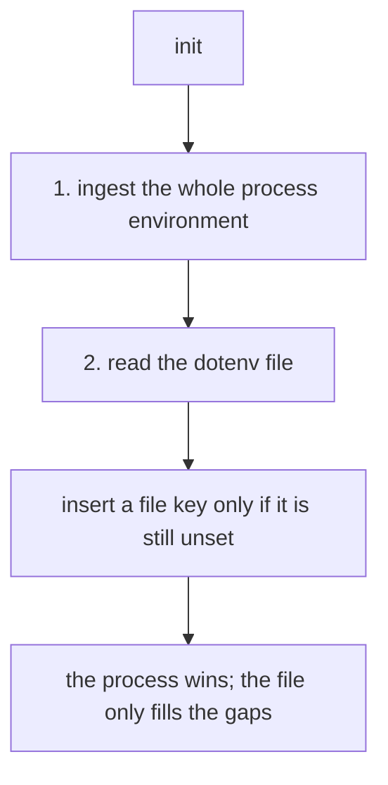

# Lifecycle

The store has a small lifecycle: one `init` at startup, one `shutdown` at
teardown, and a fixed order between them. Everything the store will ever hold is
decided at `init` — nothing grows later.

```cpp
#include <frameworkcpp/environment/environment.hpp>

void init(arena::arena_t &arena, const environment_config_t &config = {});
void shutdown() noexcept;
```

## init

`init` does four things, in order:

1. Validates the configuration and computes the module's footprint.
2. Carves a shard out of the arena and lays out the key table, value pool,
   journal and the view storage. If the arena has no room, it throws
   `std::runtime_error` (and `std::invalid_argument` if a capacity is zero).
3. Loads the **process environment** first (unless `read_process_env_` is off).
4. Loads the **dotenv file** after (if `dotenv_path_` is set), filling only
   keys that are still unset.

### Precedence: the process wins

The file never overrides a variable the process already set. This is the classic
dotenv behaviour: the file describes defaults for a clean environment, while an
operator can still override any value with `ABC=something ./app`.



`init` ingests **the whole process environment**, not just the keys the file
mentions. That is convenient, but it costs key and value capacity — size
`max_keys_` / `max_value_len_` for the host, or set `read_process_env_ = false`
when you want the file to be the single source of truth.

To add specific defaults without inheriting everything:

```cpp
environment_config_t config;
config.read_process_env_ = false;        // start from an empty store
config.dotenv_path_ = "app.env";         // defaults live in the file
environment::init(arena, config);
environment::set_env("LOG_LEVEL", "info"); // explicit defaults
```

### Parsing the file

The parser is deliberately small and allocation-free. It understands:

- `KEY=value` lines;
- blank lines and lines starting with `#`;
- an optional `export ` prefix (`export KEY=value`);
- surrounding single or double quotes (`KEY="some value"`), which are stripped;
- leading and trailing whitespace around the key and the value.

The file is read through `mmap` (not `std::ifstream`), so ingesting it never
touches the heap. A missing file is not an error — `init` simply skips it.

## shutdown

`shutdown` releases the module's handle: subsequent `get_env` calls fall back and
`set_env` returns `false`. It does **not** free the arena — the arena owns the
memory, and unmapping it is the arena's job. Call `shutdown` after every thread
has stopped using the module and before the arena goes away.

```cpp
environment::init(arena);
// ... run your system ...
environment::shutdown();
// arena is destroyed later, reclaiming all module memory at once
```

## Threading rules

| Operation | Safe from multiple threads? |
| --- | --- |
| `get_env` | Yes — lock-free, once the module is initialized. |
| `set_env` | Yes — writers serialize on a short mutex; readers stay lock-free. |
| `init` / `shutdown` | No — call from a single thread, at startup and teardown. |

Views are per-thread and are drawn from a fixed pool (`max_threads_`). A thread
claims a free slot the first time it touches the store and hands it back when the
thread exits, so slots are recycled rather than consumed; if every slot is in use
at once, `get_env` still works by reading the global slot directly (just
slower). The arena must outlive every reader and writer.
