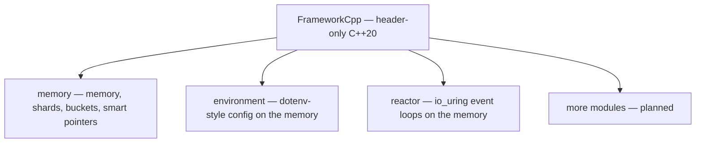

# Getting Started

Writing a real-time system in C++ is a fight against the things that make
latency unpredictable: an allocation that occasionally takes milliseconds, a
lock that stalls under contention, a global that two threads mutate at once.
FrameworkCpp is a **header-only C++20 framework** that gives you the pieces to
win that fight — memory, configuration, and the modules still to come — with no
dynamic allocation on hot paths and no locks on fast paths.

You do not adopt the whole framework at once. It is modular: each module is a
self-contained set of headers under `include/frameworkcpp/<module>/`, and you
pull in only the ones you use.



## What you need

- A C++20 compiler (GCC 10+, Clang 11+).
- CMake 3.23 or newer — only to build the tests, not to use the headers.
- A POSIX system: the memory module uses `mmap`, so Linux is the target by
  design.
- `liburing` and its headers, if you use the reactor module. It is the only
  module with an external dependency.

## Using it as a header-only library

There is nothing to install and nothing to link. Point the compiler at the
include directory and include the header you need:

```bash
git clone https://github.com/frameworkcpp/frameworkcpp.git
g++ -std=c++20 -I frameworkcpp/include app.cpp -o app
```

Every module also exposes its own version entry points
(`frameworkcpp::<module>::get_version_*`), so a binary can report what it was
built against.

## Building the tests

The repository ships CMake presets, so the classic flow just works:

```bash
cmake --preset debug
cmake --build --preset debug
ctest --preset debug
```

The other presets are `asan`, `tsan`, `ubsan`, `release` and `bench`. Sanitizer
builds pull in Clang through the preset:

```bash
cmake --preset asan && cmake --build --preset asan && ctest --preset asan
```

> TSAN needs a 64-bit platform, and sanitizers do not run on QEMU-emulated
> architectures; the CI matrix encodes exactly which combinations are valid.

## Measuring the hot paths

The `bench` preset builds an optimised binary with the Google Benchmark targets
for the memory, environment and reactor modules:

```bash
cmake --preset bench
cmake --build --preset bench
./build/bench/benchmarks/frameworkcpp_memory_bench
```

Each binary takes the usual Google Benchmark flags, so you can narrow the run or
write the results to a file. The suite reports a full distribution per
operation — `min`, percentiles, `max` — across one-thread and multi-thread
variants. See [Benchmarks](/benchmarks) for what each benchmark measures and
how to read the numbers, and [Measuring Performance](/contribute/measuring)
for the strategy behind them.

The benchmarks cover the cost of allocations, the environment API and the
reactor's post/dispatch/echo paths. They exist to tell the truth about this
commit on this machine, not to enforce a threshold: a number that moved is a
question to answer, not a failure. CI runs the same binaries natively on
`amd64` and `arm64` and uploads the JSON results as build artifacts.

## Installing it as a CMake package

To make `find_package(frameworkcpp)` available to other projects:

```bash
cmake --preset release -DFRAMEWORKCPP_BUILD_TESTING=OFF
cmake --build --preset release
cmake --install build/release --prefix /usr/local
```

A consumer project then uses it like any other package:

```cmake
find_package(frameworkcpp REQUIRED)
target_link_libraries(app PRIVATE frameworkcpp::frameworkcpp)
```

```cpp
#include <frameworkcpp/frameworkcpp.hpp>   // every module, or include one at a time

int main()
{
    using namespace frameworkcpp;

    // 1. Size the memory for everything up front.
    constexpr memory::memory_config_t mem_cfg{
        .size_ = 4 * 1024 * 1024,       // initial region: 4 MiB
        .hard_limit_ = 4 * 1024 * 1024  // hard ceiling
    };
    memory::memory_t memory{mem_cfg};

    // 2. Carve a shard for the application's hot data.
    constexpr std::uint64_t APP_SHARD = 1;
    constexpr std::uint64_t CMD_BUCKET = 0;
    auto app_shard = memory.create_shard(APP_SHARD,
        {{CMD_BUCKET, sizeof(int), alignof(int), 1024}});

    // 3. Initialise the environment module from process env + .env file.
    environment::environment_config_t env_cfg;
    env_cfg.dotenv_path_ = "app.env";
    environment::init(memory, env_cfg);

    // 4. Initialise the reactor: one queue per core, io_uring when available.
    constexpr reactor::reactor_config_t rea_cfg{
        .queues_ = 4,
        .max_jobs_per_queue_ = 1024,
        .affinity_ = true
    };
    constexpr std::size_t rea_bytes = reactor::precompute(rea_cfg);
    constexpr std::size_t total_bytes = mem_cfg.size_ + rea_bytes;
    memory::memory_config_t combined{.size_ = total_bytes};
    memory::memory_t combined_memory{combined};

    reactor::reactor_t reactor;
    reactor.bind_memory(combined_memory, rea_cfg);

    // 5. Use them: allocate, configure, serve.
    auto *cmd = app_shard.allocate<int>();
    *cmd = 42;
    app_shard.deallocate(cmd);

    const auto level = environment::get_env("LOG_LEVEL", "info");
    environment::set_env("WORKERS", "8");

    auto *queue = reactor.get_or_create("ingest");
    auto fd = socket(AF_INET, SOCK_STREAM, 0);
    auto sock = reactor.create_socket(fd, queue);
    // sock.recv(...), sock.send(...) ...

    reactor.run_all();
    // ... serve ...

    reactor.stop_all();
    environment::shutdown();
    // memory destroyed here, reclaiming everything
}
```

Prefer one include? `<frameworkcpp/frameworkcpp.hpp>` pulls in every module;
reach for the granular headers when you only need one and want faster builds.

## Where to go next

The documentation is organised by module, and each section reads top to bottom:
the idea first, then the pieces, then the details.

- [Memory](/memory/) — the memory-backed memory model: shards, buckets,
  concurrency models and smart pointers.
- [Environment](/environment/) — a dotenv-style configuration store built on top
  of the memory module.
- [Reactor](/reactor/) — io_uring event loops with lock-free queues and
  memory-carved memory.

More modules are on the way, and the menu grows with them. If you want to write
a page yourself, start with [Writing Documentation](/contribute/documentation).
