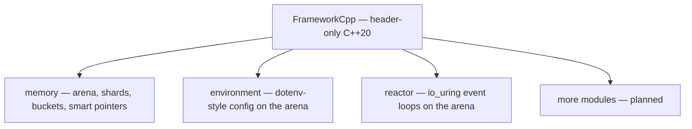

# Getting Started

Writing a real-time system in C++ is a fight against the things that make
latency unpredictable: an allocation that occasionally takes milliseconds, a
lock that stalls under contention, a global that two threads mutate at once.
FrameworkCpp is a **header-only C++20 framework** that gives you the pieces to
win that fight — memory, configuration, and the modules still to come — with no
dynamic allocation on hot paths and no locks on fast paths.

You do not adopt the whole framework at once. It is modular: each module is a
self-contained set of headers under `include/frameworkcpp/<module>/`, and you
pull in only the ones you use.



## What you need

- A C++20 compiler (GCC 10+, Clang 11+).
- CMake 3.23 or newer — only to build the tests, not to use the headers.
- A POSIX system: the memory module uses `mmap`, so Linux is the target by
  design.
- `liburing` and its headers, if you use the reactor module. It is the only
  module with an external dependency.

## Using it as a header-only library

There is nothing to install and nothing to link. Point the compiler at the
include directory and include the header you need:

```bash
git clone https://github.com/frameworkcpp/frameworkcpp.git
g++ -std=c++20 -I frameworkcpp/include app.cpp -o app
```

Every module also exposes its own version entry points
(`frameworkcpp::<module>::get_version_*`), so a binary can report what it was
built against.

## Building the tests

The repository ships CMake presets, so the classic flow just works:

```bash
cmake --preset debug
cmake --build --preset debug
ctest --preset debug
```

The other presets are `asan`, `tsan`, `ubsan` and `release`. Sanitizer builds
pull in Clang through the preset:

```bash
cmake --preset asan && cmake --build --preset asan && ctest --preset asan
```

> TSAN needs a 64-bit platform, and sanitizers do not run on QEMU-emulated
> architectures; the CI matrix encodes exactly which combinations are valid.

## Installing it as a CMake package

To make `find_package(frameworkcpp)` available to other projects:

```bash
cmake --preset release -DFRAMEWORKCPP_BUILD_TESTING=OFF
cmake --build --preset release
cmake --install build/release --prefix /usr/local
```

A consumer project then uses it like any other package:

```cmake
find_package(frameworkcpp REQUIRED)
target_link_libraries(app PRIVATE frameworkcpp::frameworkcpp)
```

```cpp
#include <frameworkcpp/frameworkcpp.hpp>   // every module, or include one at a time

int main()
{
    frameworkcpp::arena::arena_t arena;
    // carve a shard (tag 1) with one bucket (tag 0): 64 slots of int.
    auto shard = arena.create_shard(1, {{0, sizeof(int), alignof(int), 64}});

    auto *p = shard.allocate<int>();   // no malloc, no lock
    shard.deallocate(p);
}
```

Prefer one include? `<frameworkcpp/frameworkcpp.hpp>` pulls in every module;
reach for the granular headers when you only need one and want faster builds.

## Where to go next

The documentation is organised by module, and each section reads top to bottom:
the idea first, then the pieces, then the details.

- [Memory](/memory/) — the arena-backed memory model: shards, buckets,
  concurrency models and smart pointers.
- [Environment](/environment/) — a dotenv-style configuration store built on top
  of the memory module.
- [Reactor](/reactor/) — io_uring event loops with lock-free queues and
  arena-carved memory.

More modules are on the way, and the menu grows with them. If you want to write
a page yourself, start with [Writing Documentation](/contribute/documentation).
