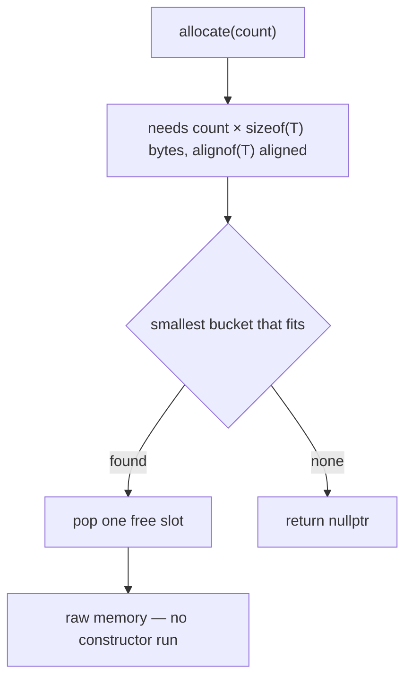

# Shards

An arena by itself is just a big reserved block. To actually use it you carve a
**shard**: a contiguous slice of that memory with its own metadata and its own
buckets. The shard view (`arena_shard_t`) is what you allocate from.

```cpp
#include <frameworkcpp/arena/arena.hpp>   // to create the shard (arena_t)
```

The examples below build an arena, so they need `arena.hpp`. If you are handed a
shard without building the arena yourself, `arena_shard_t` is in
`<frameworkcpp/arena/shard.hpp>` on its own.

## What a shard is

When the arena carves a shard, it hands out a contiguous slice and installs the
shard's metadata (its buckets and their free-lists) **inside that slice**. The
shard only ever touches its own slice — that is what makes single-thread
buckets so cheap.

A shard is identified by a **tag**. Use an enum or named constants, not magic
numbers:

```cpp
enum class shard_tag : std::uint64_t { workers_ = 1, io_ = 2 };
enum class bucket_tag : std::uint64_t { command_ = 0, payload_ = 1 };

auto workers = arena.create_shard(
    static_cast<std::uint64_t>(shard_tag::workers_),
    {
        // { tag, object_size, align, count }
        {static_cast<std::uint64_t>(bucket_tag::command_),
         sizeof(std::uint32_t),
         alignof(std::uint32_t),
         512},   // 512 slots of 4 bytes
        {static_cast<std::uint64_t>(bucket_tag::payload_),
         128,
         16,
         256},   // 256 slots of 128 bytes, aligned to 16
    });
```

Each `object_spec_t` declares one **bucket**: `object_size` bytes per slot,
`align` for the slot alignment, `count` slots reserved.

## Allocating

```cpp
template <typename T>
T* allocate(std::size_t count = 1);              // raw, uninitialized

std::byte* allocate_bytes(std::size_t bytes, std::size_t alignment);
std::byte* allocate_tagged(std::uint64_t tag, std::size_t bytes, std::size_t alignment);
```

- `allocate<T>(count)` picks the **smallest bucket that fits**: it needs a slot
  of `count * sizeof(T)` bytes with at least `alignof(T)` alignment. If nothing
  fits, it returns `nullptr`.
- Allocation does **not** run a constructor — you get raw memory.
- `allocate_tagged` addresses a specific bucket by its tag, bypassing the
  smallest-fit search.



```cpp
auto *slot = workers.allocate<std::uint32_t>();
*slot = 42;
```

## Freeing

```cpp
template <typename T>
void deallocate(T* p) noexcept;
void deallocate_bytes(void* p) noexcept;
```

Each slot carries a small header that records which bucket owns it, so the shard
pushes the slot back onto that bucket's free-list. The header stores the owning
block as an **offset** from the shard's base rather than a raw pointer, so the
metadata stays valid wherever the region is mapped.

Free through the shard that handed out the slot. A pointer that does not belong
to this shard (including one from a different shard) is ignored, not freed:
there is deliberately no cross-shard `deallocate`, since that would need a
global owner lookup.

```cpp
workers.deallocate(slot);   // back to its bucket, reusable
```

## Grabbing a bucket directly

```cpp
arena_bucket_t get_bucket(std::uint64_t tag, concurrency_model_t model);
```

`get_bucket(tag, model)` hands you a handle to one specific bucket and fixes
that bucket's [concurrency model](index#concurrency-is-a-per-bucket-choice).
The **first** call for a tag fixes the model for good.

## Diagnostics

```cpp
std::uint32_t  get_bucket_count() const noexcept; // buckets in this shard
bucket_stats_t get_stats(std::uint32_t index) const noexcept; // in_use_ / freed_ per bucket
std::uint64_t  get_tag() const noexcept;
std::uint32_t  get_shard_id() const noexcept;
explicit operator bool() const noexcept;          // false = the shard does not exist
```

## A full example

```cpp
using namespace frameworkcpp::arena;

arena_t arena;
auto shard = arena.create_shard(
    1,
    {{0, sizeof(std::uint32_t), alignof(std::uint32_t), 256}}); // bucket "0": 256 slots of uint32

auto* slot = shard.allocate<std::uint32_t>();
*slot = 42;

shard.deallocate(slot);                      // back to the bucket, reusable
std::cout << shard.get_stats(0).freed_ << "\n";   // 1
```
