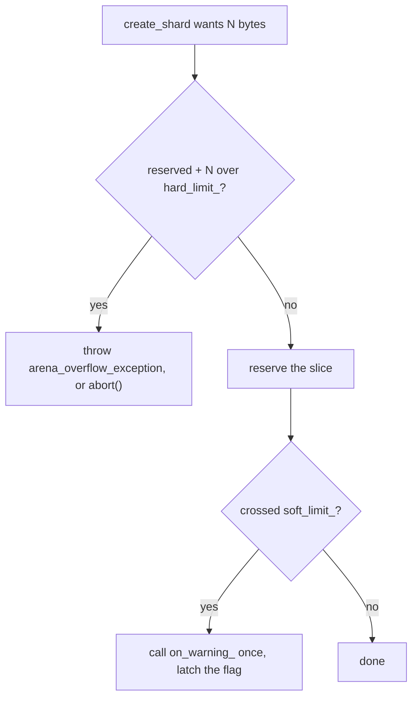

# The Arena

The arena is where the whole model starts. Before you can hand out memory
without allocating, something has to reserve that memory once and own it — that
something is `arena_t`.

```cpp
#include <frameworkcpp/arena/arena.hpp>   // arena_t lives here (and the umbrella)
```

The configuration types (`arena_config_t`, `overflow_mode_t`, …) arrive through
the same include; they live on their own in `<frameworkcpp/arena/config.hpp>`.

## Configuring an arena

You build an arena from an `arena_config_t`. Every field is optional — the
defaults are sensible for development, and you tighten them for real-time:

```cpp
arena_config_t config;

config.size_        = 1024 * 1024;  // initial region, in bytes
config.soft_limit_  = 0;            // warn when reserved bytes reach this (0 = off)
config.hard_limit_  = 0;            // hard ceiling on reserved bytes (0 = uncapped)
config.overflow_    = overflow_mode_t::throw_error_; // throw, or abort() instead
config.on_warning_  = nullptr;      // callback fired once when soft_limit is crossed
config.touch_pages_ = false;        // MAP_POPULATE: commit pages up front

arena_t arena{config};
```

A few things worth knowing before you pick numbers:

- `size_` is the first region. The arena may reserve more later, up to
  `hard_limit_`.
- With `hard_limit_ = 0` (the default) the arena grows without a ceiling —
  handy in development, not what you want for a hard deadline.
- `soft_limit_` and `hard_limit_` are enforced on **reserved bytes** (what the
  mmap segments occupy), not on live objects.
- Crossing the hard limit while carving a shard throws
  `arena_overflow_exception` (or aborts, if `overflow_ == overflow_mode_t::abort_`).
  Crossing the soft limit calls `on_warning_` once and latches
  `arena.is_soft_limit_exceeded()`.



## Carving shards

```cpp
arena_shard_t create_shard(std::uint64_t tag, std::initializer_list<object_spec_t> specs);
arena_shard_t create_shard(std::uint64_t tag, std::span<const object_spec_t> specs);
```

- `tag` is the shard's identity. Asking for a tag you already created returns
  the same shard again (idempotent). A tag is just a `std::uint64_t` — use an
  enum or named constants so your code reads clearly.
- `specs` are the **buckets** the shard will hold. `create_shard` reserves the
  whole slice up front (headers, free-list metadata and all the slots), so a
  failed carve costs nothing and a successful one never grows later.
- `get_shard(tag)` fetches an existing shard by tag, or an empty (falsy) view
  when it does not exist.

## The arena owns, the shard frees

The arena owns the memory and the budget; freeing is the shard's job. Keep the
shard view next to the pointer it handed out:

```cpp
arena_t arena;
auto shard = arena.create_shard(...);
auto *slot = shard.allocate<std::uint32_t>();
// ...
shard.deallocate(slot);
```

There is no `arena.deallocate`. A slot is only freed through the shard that
owns its bucket, so the arena needs no per-slot bookkeeping and stays free of
any global "find the owner from the pointer" state.

## Not copyable, not movable

`arena_t` owns its regions and pins them with an intrusive registry, so it is
neither copyable nor movable. Keep it in a stable location (a local, a member,
or a `std::unique_ptr`) and keep it alive while any shard or slot you got from
it is still in use.

## Knowing the budget

When you are tuning a deadline, you want to see the numbers move. These
accessors report the arena's state:

```cpp
std::size_t get_shard_count() const noexcept; // how many shards have been carved
std::size_t get_capacity()    const noexcept; // total bytes reserved (all regions)
std::size_t get_used()        const noexcept; // bytes carved so far (high-water mark)
std::size_t get_live()        const noexcept; // slots currently in your hands
std::size_t get_hard_limit()  const noexcept;
std::size_t get_soft_limit()  const noexcept;
bool        is_soft_limit_exceeded() const noexcept;
```

## A full example

Putting it together: two buckets in one shard, with a hard budget and a check on
the reserved bytes.

```cpp
using namespace frameworkcpp::arena;

// Tag the shard and the buckets so the numbers mean something.
enum class shard_tag : std::uint64_t { workers_ = 1 };
enum class bucket_tag : std::uint64_t { command_ = 0, counter_ = 1 };

arena_config_t config;
config.hard_limit_ = 4 * 1024 * 1024;   // the stock: never reserve past 4 MiB
arena_t arena{config};

auto workers = arena.create_shard(
    static_cast<std::uint64_t>(shard_tag::workers_),
    {
        {static_cast<std::uint64_t>(bucket_tag::command_),
         sizeof(std::uint32_t),
         alignof(std::uint32_t),
         512},
        {static_cast<std::uint64_t>(bucket_tag::counter_),
         sizeof(std::uint64_t),
         alignof(std::uint64_t),
         512},
    });

std::cout << "reserved: " << arena.get_capacity() << " bytes\n";
```

**When not to cap it:** during development, an unbounded arena lets you move
fast; the ceiling is for production, where an overshoot should fail loudly at
startup instead of surfacing as a missed deadline under load.
