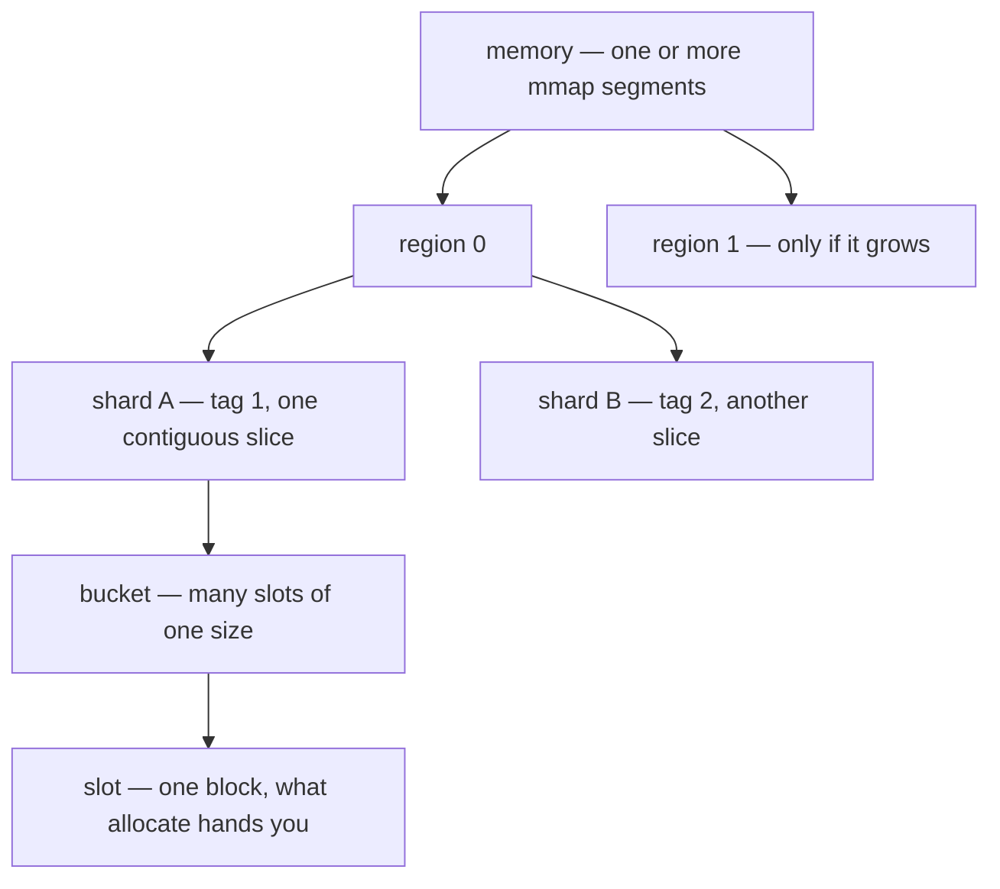

# Memory

A real-time system cannot afford a `malloc` here and there, a lock that stalls
under contention, or memory that appears and disappears without a plan. Every
one of those is a source of latency you cannot bound.

`frameworkcpp::memory` is the framework's answer. It reserves memory up front
with `mmap`, hands it out in slices, and recycles freed blocks back into the
memory — so the hot paths never allocate and never take a lock. The whole module
is header-only.

## The vocabulary

Four words explain the entire module:

| Concept | What it is |
| --- | --- |
| **Memory** | The owner of all the memory. It reserves one or more `mmap` segments and carves shards out of them. The memory store knows the budget. |
| **Shard** | A contiguous slice of the memory store's memory, identified by a tag. Only the slice's contents belong to the shard. |
| **Bucket** | A pool of same-size slots inside a shard, identified by a tag. All its slots share one size and one alignment. |
| **Slot** | One block of memory inside a bucket. Allocating hands you a slot; freeing returns it. |

## The mental model

1. You create an **memory** and tell it your budget (or let it grow).
2. You **carve shards** out of it with `create_shard(tag, specs)`. Each shard
   gets its own slice of memory — 64-byte aligned, so high-alignment buckets
   stay correct no matter what came before.
3. Inside a shard you declare **buckets** — pools of same-size slots — with
   `object_spec_t` entries.
4. You allocate **slots** from buckets; when you free a slot it goes back to
   its bucket for reuse. Nothing is returned to the OS until the memory store dies.

## Concurrency is a per-bucket choice

Whether a bucket is safe to share is a decision you make when you grab its
handle. You pick one of three models:

| Model | What it means | Cost |
| --- | --- | --- |
| Single-thread | One thread owns the bucket end to end. | nothing — plain fields |
| Lock-free | Several threads allocate/free without locks. | atomics only |
| Thread-safe | Safe from anywhere without thinking. | a shared mutex |

The model is fixed the first time the bucket is used. Asking for a different one
later aborts the program — the choice is not a per-call detail, it is part of
the bucket's contract.

## The budget

A memory store can be capped. You set a **soft limit** (a warning watermark) and a
**hard limit** (the hard ceiling). Growing past the soft limit warns; growing
past the hard limit throws `memory_overflow_exception` (or aborts, if you
configure it). See [Configuration](configuration) for the details.

## The headers

The module is split so you include only what you use. Pick the header that
matches the piece you touch:

| You are using | Include |
| --- | --- |
| The memory store itself (`memory_t`) and the whole module | `<frameworkcpp/memory/memory.hpp>` |
| A shard view (`memory_shard_t`) | `<frameworkcpp/memory/shard.hpp>` |
| A bucket handle (`memory_bucket_t`) | `<frameworkcpp/memory/bucket.hpp>` |
| Unique pointer (`memory_unique_ptr_t`) | `<frameworkcpp/memory/unique_ptr.hpp>` |
| Shared pointer (`memory_shared_ptr_t`) | `<frameworkcpp/memory/shared_ptr.hpp>` |
| Standard allocator / PMR bridge | `<frameworkcpp/memory/memory_allocator.hpp>` |
| Configuration types only | `<frameworkcpp/memory/config.hpp>` |

`memory.hpp` is the umbrella: it includes everything, so snippets that need to
*build* a memory store just include it. The granular headers matter when the memory store
already exists and you only touch one piece.

## The pieces

Read them top to bottom — each page builds on the previous one:

- [The Memory Store](memory-t) — owns the memory, your budget, and how to carve shards.
- [Shards](memory-shard-t) — the slices and how allocation finds the right bucket.
- [Buckets](memory-bucket) — the pools of same-size slots and how to grab one directly.
- [Smart Pointers](smart-pointers) — owning and shared pointers that return memory on their own.
- [Allocators & std::pmr](allocator) — the standard allocator bridge for `std::vector`.
- [Configuration](configuration) — the knobs and the compile-time footprints.
