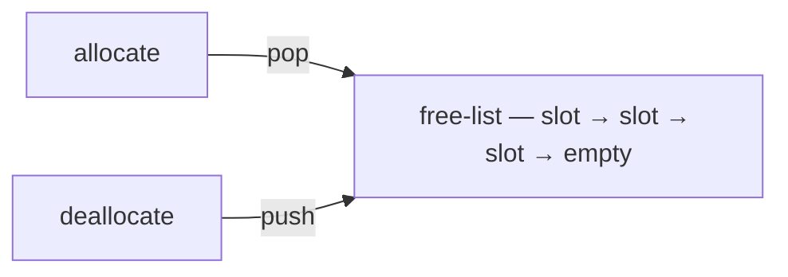

# Buckets

A shard gives you isolation; a **bucket** gives you speed. Every slot in a
bucket shares one size, one alignment and one free-list, so allocating is a pop
and a store — no search for a hole that fits.

A bucket is never created on its own. It is declared when you create the shard,
as one `object_spec_t` entry, and you later grab a handle to it with
`shard.get_bucket(tag, concurrency_model_t)`.

```cpp
#include "frameworkcpp/memory/memory.hpp">   // to build the memory store + shard in the examples
```

The handle itself — `memory_bucket_t` — lives in
`<frameworkcpp/memory/bucket.hpp>`; include that directly when you receive a
bucket without building the memory store.

## Declaring a bucket

A bucket lives inside a shard's `create_shard` call. Each `object_spec_t` entry
becomes one bucket:

```cpp
enum class bucket_tag : std::uint64_t { commands_ = 0, payloads_ = 1 };

auto shard = memory.create_shard(
    1, // shard tag
    {
        // { tag,               object_size,        align, count }
        {static_cast<std::uint64_t>(bucket_tag::commands_), sizeof(std::uint64_t),
         alignof(std::uint64_t), 1024}, // 1024 slots of 8 bytes
        {static_cast<std::uint64_t>(bucket_tag::payloads_), 256, 64, 64},
        //                           256 slots of 256 bytes, aligned to 64
    });
```

## Holding a bucket

```cpp
memory_bucket_t get_bucket(std::uint64_t tag, concurrency_model_t model);
```

- Pass the **bucket tag** you declared, and the **concurrency model** this
  bucket will use.
- The **first** call for a tag fixes the bucket's model. Requesting a different
  model afterwards aborts the program.
- The handle is empty (falsy) if no bucket with that tag exists in the shard.

## Using it

```cpp
template <typename T>
T* allocate(std::size_t count = 1);    // nullptr if the slot is too small

template <typename T>
void deallocate(T* p) noexcept;
void deallocate_bytes(void* p) noexcept;

std::uint64_t get_tag() const noexcept;
explicit operator bool() const noexcept;
```

A bucket handle only hands out slots from its own pool — it never goes hunting
through the shard. Freed slots are reused within the bucket. Allocation fails
with `nullptr` when the request is bigger than the bucket's `object_size_` or
more aligned than the bucket allows.



## A full example

```cpp
using namespace frameworkcpp::memory;

memory_t memory;
auto shard = memory.create_shard(
    1,
    {{0, sizeof(std::uint64_t), alignof(std::uint64_t), 1024}}); // one bucket, tag 0

auto bucket = shard.get_bucket(0, concurrency_model_t::lock_free_);

auto* slot = bucket.allocate<std::uint64_t>(); // only ever from bucket 0
if (slot) *slot = 7;
bucket.deallocate(slot);
```
