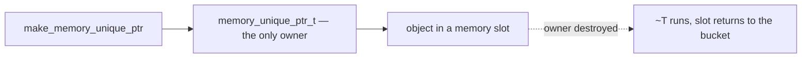
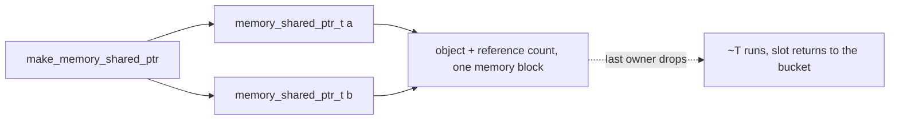

# Smart Pointers

Raw slots are fast, but a raw slot will not run your destructor or give the
block back when you forget to. When you want the lifetime handled for you, the
memory ships two RAII owners: they construct the object, run its destructor, and
hand the block back to the memory — no `new`, no `delete`.

```cpp
#include <frameworkcpp/memory/unique_ptr.hpp>   // memory_unique_ptr_t
#include <frameworkcpp/memory/shared_ptr.hpp>   // memory_shared_ptr_t + enable_shared_from_this
#include <frameworkcpp/memory/memory.hpp>        // to build the memory in the examples
```

## Unique ownership

`memory_unique_ptr_t<T>` is a move-only owner. When it dies or is reset, it
destroys the object and returns the block to the memory.

```cpp
template <typename T, typename... Args>
memory_unique_ptr_t<T> make_memory_unique_ptr(memory_shard_t& shard, Args&&... args);
```

```cpp
memory_t memory;
auto shard = memory.create_shard(1, {{0, 64, alignof(std::max_align_t), 32}});

{
    auto p = make_memory_unique_ptr<Widget>(shard, /* ctor args */);
    if (!p) { /* shard had no bucket large enough */ }
    p->run();
} // ~Widget() runs and the block goes back to the memory
```

`get()`, `operator->`, `operator*`, `operator bool` and `reset()` behave like
`std::unique_ptr`, with one difference: the pointer is always created through
the factory, so the memory that owns the block is never out of sync. It is
move-only — there is no copy, and no way to build it from a raw pointer.



## Shared ownership

When an object outlives its creator or is handed around, you want a reference
count. `memory_shared_ptr_t<T>` keeps that count **inside the same memory block**
as the object, so sharing costs no extra allocation. The block returns to the
memory when the last owner lets go.

```cpp
template <typename T, typename... Args>
memory_shared_ptr_t<T> make_memory_shared_ptr(memory_shard_t& shard, Args&&... args);
```

```cpp
struct job_t : memory_enable_shared_from_this_t<job_t>
{
    int id_;
};
```

```cpp
memory_t memory;
auto shard = memory.create_shard(1, {{0, 128, alignof(std::max_align_t), 16}});
{
    auto a = make_memory_shared_ptr<job_t>(shard, 42);
    auto b = a;              // both own the same job
}                            // last owner gone → ~job_t + back to the memory
```



It supports the usual shared semantics — copy, move, reset, `operator->`,
converting from a derived type — plus `shared_from_this()` when `T` derives from
`memory_enable_shared_from_this_t<T>`:

```cpp
auto a = make_memory_shared_ptr<job_t>(shard, 1);
auto b = a->shared_from_this();   // another owner of the same object
```

`shared_from_this()` throws `std::bad_weak_ptr` when the object was not created
through `make_memory_shared_ptr`, matching the standard behaviour. Weak
references are not part of the memory module yet.

## Which to use

- One owner, no sharing: **unique**.
- The object outlives its creator or is handed around: **shared**.
- Neither, and you just need a scratch buffer: allocate raw through the
  [shard](memory-shard-t) and free it by hand.

**When not to reach for these:** every owned pointer stores a shard handle and,
for the shared one, a control block. If your data never outlives the call, a raw
slot from a bucket is cheaper and allocation-free.
