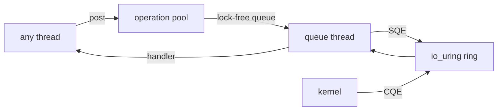
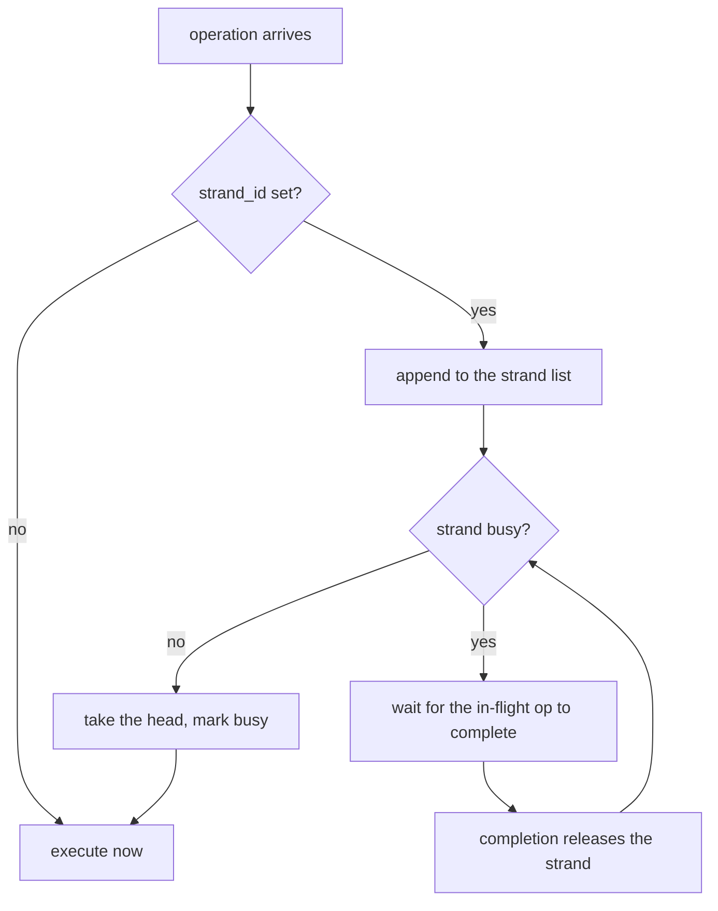

# Internals

The reactor has three moving parts: a ring that talks to the kernel, a pool of
operations that hands work between threads, and a strand protocol that keeps
related operations from overlapping.



## The io_uring ring

Each queue owns one `io_uring` ring, created when the reactor is bound. The
kernel maps the submission and completion queues into the process, so:

- posting an operation is a write into a shared array — no syscall;
- waiting for a completion is a read from the kernel's array — no syscall
  either, unless the kernel has nothing pending, in which case the thread
  sleeps with a timeout so it can notice a stop request.

That is the whole point of `io_uring` over `epoll`: the kernel batches the
syscalls, and a batch of one hundred operations costs one syscall instead of a
hundred.

## The operation pool

Operations are fixed-size records carved from the arena. Each queue owns a
contiguous segment of the pool, and the queue's own queue of pending operations
is a ring of pointers into that segment.

The pool is what makes `post` safe on a real-time path: the record already
exists, so posting an operation is a pointer store, never an allocation.

An operation carries everything the handler needs:

```cpp
struct op_t {
    op_kind_t kind_;       // what to do
    int fd_;               // which socket
    void *buffer_;         // where the data goes (zero-copy)
    std::size_t len_;      // how much
    reactor_fn_t fn_;      // who to call
    void *ctx_;            // with what
    std::uint64_t strand_id_;  // serialisation key
    int priority_;         // reserved
    op_result_t result_;   // filled in on completion
    bool done_;            // free when true
    op_t *next_;           // strand list
};
```

`done_` is the free flag. An operation is reusable once its handler has run,
and the pool is searched linearly for a free one — the pool is small and the
search stays in cache.

## The handoff between threads

Any thread can post to any queue. The queue's pending operations live in a
ring with two atomic indices:

```cpp
class op_queue_t {
  std::atomic<std::size_t> head_;  // consumer
  std::atomic<std::size_t> tail_;  // producer
  op_t **slots_;
};
```

The producer publishes by writing the pointer into the slot and then bumping
`tail_` with a release store; the consumer reads `tail_` with an acquire load
and bumps `head_`. There is no lock, no condition variable and no allocation.
The cost is a single atomic store per post.

## Who touches what

The reactor has three kinds of state and each one has a single owner:

| State | Owner | How other threads reach it |
| --- | --- | --- |
| Operation pool | anyone | a compare-exchange takes a free operation, so two threads posting at once never take the same one |
| Timer heap | the queue's thread | a timer is scheduled by queueing an operation; the thread puts it in the heap |
| Socket slots | the queue's thread | the pending operation, the close flag and the closed flag are atomics |

That is why the timer heap needs no lock and the operation pool needs no
mutex: the heap is touched by one thread, and the pool hands out operations
atomically. Scheduling and cancelling a timer are both requests that travel
through the operation queue, so the caller never touches the heap.

Closing a socket follows the same rule. The caller does not close the
descriptor: it queues a request, and the queue's thread closes it once no
operation is in flight for that socket. Closing a descriptor from the caller's
thread while the queue is using it would be a race on the file descriptor, and
it would leave the pending operation without an owner.

## The strand protocol

A strand is a serialisation key: operations sharing a `strand_id` must not run
at the same time.

Each strand holds a list of pending operations and one flag, `busy`:

```cpp
class strand_t {
  std::atomic<op_t *> head_;
  std::atomic<op_t *> tail_;
  std::atomic<bool> busy_;
};
```

The queue's thread is the only one that touches a strand, so the list needs no
lock. The protocol is simple:

1. `try_dispatch` returns the first pending operation **only if** the strand is
   not busy, and sets `busy`.
2. The operation is submitted to `io_uring` and the strand stays busy while it
   is in flight — that is the part a naive implementation gets wrong. A second
   operation on the same strand waits for the first to *complete*, not merely to
   be dispatched.
3. When the completion arrives, the handler runs and the strand is released.



## The memory layout

`bind_arena` carves one shard with six blocks:

| Block | Holds |
| --- | --- |
| Queue controls | One per queue: the `io_uring` ring, the operation queue, the strand pointer. |
| Queue handles | The `queue_t` values you get back from `get_or_create`. |
| Operations | The pool. Split into contiguous segments, one per queue. |
| Ring slots | The array of pointers that makes up each queue's pending-operation ring. |
| Sockets | The socket table. |
| Strands | The strand table, shared by every queue. |

`precompute(config)` builds the same table of descriptors and asks the arena
how many bytes it would take, so the number you budget at compile time is the
number the reactor carves at runtime. The reactor test asserts exactly that.

## Moving a connection between threads

A socket is not owned by a thread: it is registered in a queue, and the queue's
thread completes its operations. Moving a connection to another thread means
pointing the socket at another queue — the file descriptor stays open, and the
connection is never interrupted.

The one rule is that the socket must be **idle**. A pending read belongs to the
queue that will complete it, so a socket with operations in flight has an owner
and cannot move. Each socket slot carries a counter of its in-flight
operations:

```cpp
struct socket_slot_t {
  int fd_ = -1;
  queue_t *queue_ = nullptr;
  std::uint64_t socket_id_ = 0;
  std::atomic<std::uint32_t> inflight_{0};
};
```

The counter is incremented when the operation is posted and decremented when
its completion arrives. `migrate` refuses to move a socket whose counter is not
zero, and `rebalance` skips those sockets and leaves them for a later round.

Because `io_uring` resolves the descriptor when the operation is submitted,
there is nothing to deregister: the next operation posted to the target queue
simply runs on the target's ring.

## Strands are per queue

Each queue owns a segment of the strand table, and only its own thread touches
it. A strand therefore cannot be contended by two threads, and the `busy` flag
that serialises a strand never needs to be a cross-thread atomic.

When a socket migrates, its strand moves with it: the strand id is interpreted
in the target queue's segment from that moment on.

## The timer heap

Each queue owns a segment of the timer pool and a binary heap over it. A
timer is an `op_t` with a deadline instead of a descriptor, so firing it is
the same code path as completing any other operation.

The heap is over pointers to ops that live in the arena, so inserting a timer
costs no allocation. Each op remembers its position in the heap, which makes
cancelling a timer by id a removal rather than a scan.

The queue's loop reads the nearest deadline before it waits, and sleeps exactly
until then (capped at a millisecond so a stop request is noticed promptly).

A timer with a strand does not run when it expires: it joins the strand's
queue, so it cannot overlap the operation the strand is busy with.

## Addresses live in the operation

The kernel writes the peer's address into the operation for `accept` and
`recvfrom`, and reads the destination from it for `sendto` and `connect`. That
address has to survive until the completion arrives, so each operation carries
its own `sockaddr_storage` and `msghdr`.

The cost is size: an operation is a few hundred bytes, not a few dozen. It is
memory you pay for once, at compile time, out of the arena — and a queue's
operation pool is sized by `max_jobs_per_queue_`, so a system that does not
need datagrams can keep that number small.

## What the architecture has to guarantee

The hot path promises two things: no locks and no allocation. Both depend on
the target architecture, so the framework states them as compile-time facts
instead of assuming them:

```cpp
static_assert(std::atomic<std::size_t>::is_always_lock_free,
              "the operation ring needs lock-free size_t atomics");
static_assert(std::atomic<std::uint64_t>::is_always_lock_free,
              "the reactor needs lock-free 64-bit atomics");
```

On a 64-bit architecture this is free. On a 32-bit one it is not: a 64-bit
atomic without an exclusive-access instruction falls back to a library call
that takes a lock, and the promise would be a lie. `armv7` has
`LDREXD`/`STREXD` and keeps it; `armv6` would not.

The `tools/cross-check.sh` script compiles the framework for `armv7`, `s390x`,
`riscv64` and `ppc64le` — the architectures the CI emulates — and the
compiler answers the question on each of them. It needs no root and no
emulation, so it runs in seconds instead of the hours an emulated build takes.

## What is not implemented yet
- **Automatic rebalancing.** `rebalance()` is a call you make; the reactor does
  not run it on a schedule on its own.
